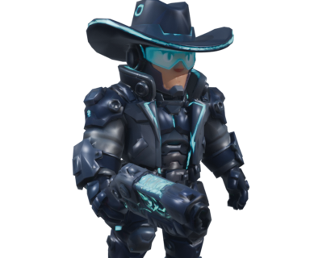
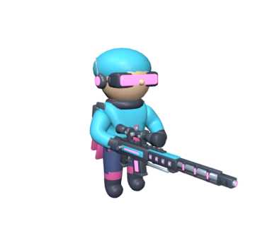
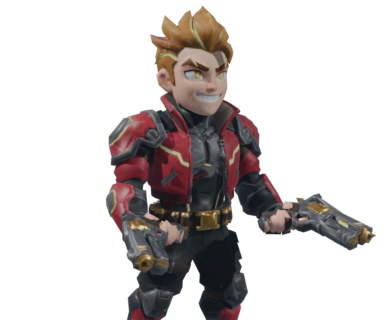
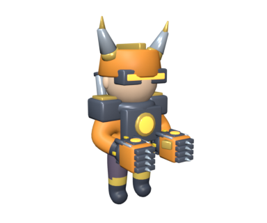
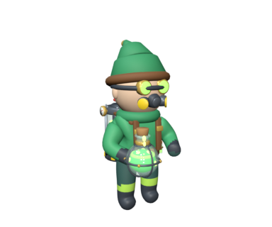
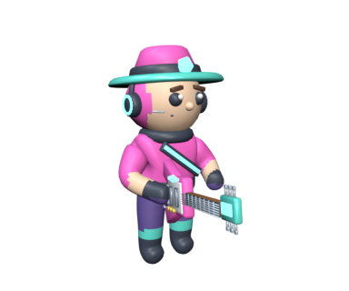
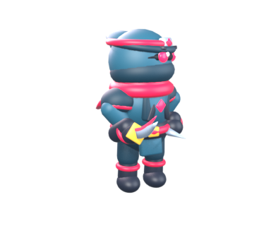
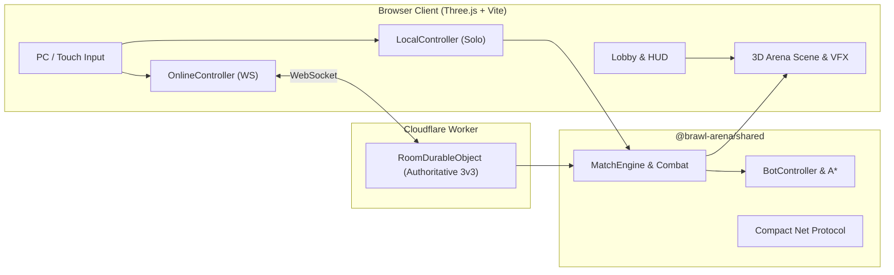

<div align="center">

# ⚡ BRAWL ARENA

**A fast-paced 3D 3v3 real-time multiplayer arena brawler built with Three.js, TypeScript, and Cloudflare Durable Objects.**

### 🚀 [Play Live on Cloudflare Workers →](https://brawl-arena.harisharraz02.workers.dev)

[](https://brawl-arena.harisharraz02.workers.dev)
[](https://www.typescriptlang.org/)
[](https://threejs.org/)
[](https://developers.cloudflare.com/durable-objects/)
[](https://vite.dev/)
[](https://vitest.dev/)
[](https://playwright.dev/)

*Play solo against tactical A\* bots or jump into live 3v3 online rooms with friends — straight from the browser on desktop or mobile.*

</div>

---

## ✨ Highlights

- **⚔️ 7 Playable 3D Brawlers** — Custom rigged GLB characters with smooth 5-clip skeletal animation (`Idle`, `Run`, `Attack`, `Victory`, `Defeat`), stylized emissive shaders, distinct projectiles, and bespoke Supers.
- **🎮 2 Competitive 3v3 Modes** — **Gem Grab** (race to 10 gems and survive the 15s countdown) and **Brawl Ball** (2-goal arcade soccer with passing, Super kicks, tackles, and wall-shattering overtime).
- **🗺️ 3 Symmetric Arenas** — **Crystal Cavern**, **Twin Bridges**, and **Iron Foundry**, each 180° rotationally symmetric with stealth bushes, water/lava hazards, and destructible cover.
- **🌐 Authoritative Online Multiplayer + Instant Solo** — Shared deterministic simulation runs identically inside **Cloudflare Durable Objects** (WebSockets + room codes) and locally in the browser for zero-latency solo practice.
- **🤖 Smart Tactical Bot AI** — Grid A\* pathfinding, stealth-bush respect (no wallhacks), gem-carrier protection, Brawl Ball passing/tackling, and anti-AFK objective awareness.
- **📱 Cross-Platform Controls & Audio** — Seamless mouse + keyboard on desktop, adaptive landscape twin-stick touch controls on mobile, live aim telegraphs, combat kill feed, and synthesized Web Audio SFX/BGM.

---

## 🦸 Meet the Brawlers

| Portrait | Brawler | Role | HP / Speed | Primary Attack | Super Ability |
| :---: | :--- | :--- | :---: | :--- | :--- |
|  | **Buck**<br><sub>Blast Ranger</sub> | Shotgunner | `5400` / `3.70` | 5-pellet close-range cone shotgun blast (`400×5`) | **Mega Blast** — 9-pellet shockwave with heavy knockback that smashes cover walls |
|  | **Vex**<br><sub>Star Sniper</sub> | Sharpshooter | `3000` / `3.55` | Distance-scaling plasma rail bolt (`560–1980`) | **Sky Drop** — Leaps over walls while dropping 3 cover-breaking bombs |
|  | **Blaze**<br><sub>Twin Striker</sub> | Rapid Dualist | `3900` / `3.85` | High-tempo 6-round twin revolver burst (`280×6`) | **Bullet Storm** — 10 piercing high-velocity rounds that shred breakable cover |
|  | **Golem**<br><sub>Iron Titan</sub> | Heavy Tank | `7800` / `3.45` | Piercing triple shock-punch combo (`320×3`) | **Meteor Slam** — Vaults over walls & water to slam terrain with massive knockback |
|  | **Mort**<br><sub>Hex Alchemist</sub> | Thrower | `3300` / `3.55` | Lobbed toxic flask over walls (`540` + `480/s` puddle) | **Acid Rain** — Spread volley of 5 toxic flasks for wide area denial |
|  | **Lumi**<br><sub>Pulse Virtuoso</sub> | Support / Healer | `4500` / `3.65` | Wide piercing acoustic wave (`740`) | **Encore Pulse** — Wall-piercing wave that restores `2800` HP to self & allies |
|  | **Kage**<br><sub>Shadow Blade</sub> | Assassin | `3600` / `4.35` | High-speed katana **Shadow Dash** piercing enemies (`1200`) | **Phantom Slash** — Wall-piercing shadow wave (`1300`) with `80%` lifesteal |

---

## 🏟️ Game Modes & Arenas

### Modes
| Mode | Objective | Match Flow |
| :--- | :--- | :--- |
| **💎 Gem Grab** | Collect and hold **10 gems** from the central mine. | Triggers a **15s** victory countdown; eliminating a carrier drops all their gems. `3:30` max match + Sudden Death tiebreaker. |
| **⚽ Brawl Ball** | Score **2 goals** in the enemy net. | Pick up the ball to dribble, kick with Primary, blast through cover with Super, or lunge-**Tackle** (`Shift`/`E`) to strip possession. `2:30` regulation + `60s` Sudden-Death Overtime. |

### Arenas
- **Crystal Cavern** — Classic side bush lanes and central breakable crate clusters.
- **Twin Bridges** — Water channels funneling action across three contested mid-lane bridges.
- **Iron Foundry** — Industrial steelworks with molten slag flank moats, central magma trench, and bunker cover.

---

## 🎮 Controls

| Action | Desktop (Keyboard + Mouse) | Mobile (Landscape Touch) |
| :--- | :--- | :--- |
| **Move** | `W A S D` or Arrow Keys | Left Virtual Joystick |
| **Aim & Shoot / Kick** | Mouse Aim + `Left Click` | Drag & Release **AIM** Stick (tap to Auto-Aim) |
| **Super / Super Kick** | `Right Click` or `Space` | Drag & Release **SUPER** Stick (when `100%`) |
| **Auto-Aim** | `Q` | Tap **AIM** Stick |
| **Tackle** *(Brawl Ball)* | `Shift` or `E` | **TACKLE** Button |

---

## 🏗️ Architecture

Brawl Arena is structured as an npm workspaces monorepo so game rules, physics, and bot AI live in a single deterministic engine shared by both the browser client and the Cloudflare Worker backend.

```text
brawl-arena/
├── shared/     # Deterministic MatchEngine, brawlers, maps, A* pathfinding, BotController, net protocol
├── client/     # Three.js 3D renderer, GLB model & animation bank, VFX, HUD, Web Audio SFX, local/online controllers
├── worker/     # Cloudflare Worker API + RoomDurableObject (authoritative WebSocket multiplayer rooms)
└── e2e/        # Playwright end-to-end browser verification suite
```



---

## 🚀 Quick Start

### Prerequisites
- **Node.js** `>= 20` and **npm**

### 1. Install Dependencies
```bash
npm install
```

### 2. Run Locally (Client + Multiplayer Worker)
Open two terminals:

```bash
# Terminal 1 — Cloudflare Worker + Durable Objects (http://127.0.0.1:8787)
npm run dev:worker

# Terminal 2 — Vite 3D Client (http://localhost:5173)
npm run dev:client
```

Then open **http://localhost:5173/** in your browser.
- Click **Play Solo** for an instant 3v3 bot match.
- Click **Online Room** to create or join a 4-letter room code with friends (unfilled slots auto-fill with bots).

### 3. Build, Test & Deploy
```bash
# Typecheck all workspaces & build production client bundle
npm run build

# Run unit & simulation test suite (Vitest)
npm test

# Run Playwright end-to-end browser tests
npm run test:e2e

# Build & deploy static assets + Worker to Cloudflare
npm run deploy
```

> **CI/CD:** Connected to **Cloudflare Workers Builds** on `main` — every push automatically builds the monorepo and deploys live to [brawl-arena.harisharraz02.workers.dev](https://brawl-arena.harisharraz02.workers.dev).

---

## 🧪 Test Coverage

- **Unit & Simulation Tests (`npm test`)** — 12 test suites (`73` tests) covering map symmetry & wall collision, combat & super mechanics, Kage dash & lifesteal, full 60-second simulated 3v3 Gem Grab and Brawl Ball bot matches, input throttling, perspective projection, projectile meshes, combat feed, victory podium, and `RoomDurableObject` WebSocket synchronization.
- **End-to-End Tests (`npm run test:e2e`)** — Playwright verification for lobby boot, brawler portrait loading, character selection, and live match startup.

---

## 🛠️ Tech Stack

- **3D Rendering & Animation:** Three.js (`GLTFLoader`, `SkeletonUtils`, custom emissive + toon PBR tuning, procedural VFX)
- **Simulation & AI:** Strict TypeScript monorepo (`@brawl-arena/shared`) with deterministic fixed-step simulation & A\* navigation
- **Multiplayer Edge Backend:** Cloudflare Workers + SQLite-backed Durable Objects (`wrangler`)
- **Tooling & QA:** Vite 6, Vitest 3, Playwright, Blender 3D rigging/animation pipeline

---

<div align="center">
  Built with ⚡ Three.js & Cloudflare Durable Objects
</div>
